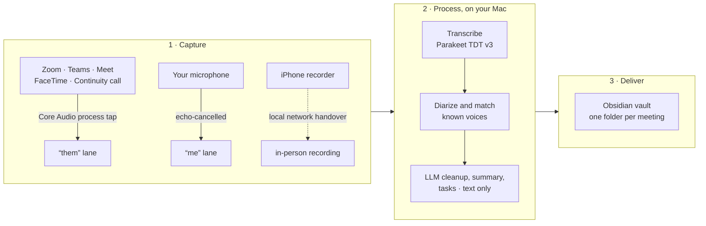

<p align="center">
  
</p>

<p align="center">
  <a href="https://github.com/NicolaiSchmid/steno/releases/latest"></a>
  <a href="https://github.com/NicolaiSchmid/steno/actions/workflows/rust-ci.yml"></a>
  <a href="https://github.com/NicolaiSchmid/steno/actions/workflows/mobile-ci.yml"></a>
  
  
</p>

<p align="center">
  <b>Steno records your meetings without joining them, turns the recording into a summary,
  transcript and tasks on your own Mac, and writes the result into your Obsidian vault.</b><br>
  No bot in the call. No cloud account. No subscription. Audio never leaves the machine.
</p>

<p align="center">
  <a href="#install">Install</a> ·
  <a href="#how-it-works">How it works</a> ·
  <a href="#what-lands-in-your-vault">What you get</a> ·
  <a href="#features">Features</a> ·
  <a href="#privacy">Privacy</a> ·
  <a href="#phone-companion">Phone companion</a> ·
  <a href="#for-developers">Developers</a>
</p>

> **Status: stable.** [Steno 0.11.0](https://github.com/NicolaiSchmid/steno/releases/tag/v0.11.0)
> is the first stable release, one Rust app on every desktop. On the Mac it replaces the
> original Swift app as an ordinary update. Version 1.0 follows once the v1 checklist in
> [issue #74](https://github.com/NicolaiSchmid/steno/issues/74) is done. The full scope and
> every settled decision live in [`.plans/2026-09-24-initial-scope.md`](.plans/2026-09-24-initial-scope.md).

## Why Steno

Most meeting recorders join your call as a participant, upload the audio to their servers
and keep your notes behind their login. Steno takes the opposite route:

| | Hosted bot recorders | Steno |
|---|---|---|
| **Captures audio by** | A bot joins the meeting | Core Audio taps the apps already playing on your Mac |
| **Everyone on the call sees** | "Notetaker has joined" | Nothing |
| **Audio is processed** | In the vendor's cloud | On your Mac, after the meeting |
| **Notes live in** | The vendor's app | Plain files in your Obsidian vault |
| **Works for** | Supported video platforms | Zoom, Teams, Meet, FaceTime, Slack, phone calls via Continuity, in-person meetings |
| **Cost** | Monthly subscription | Free, open source, your own LLM endpoint |

It was built to match the day-to-day quality of commercial meeting recorders for one
person and their friends, with files instead of lock-in.

## Install

Every release carries the builds for all three desktops, on the
[latest release](https://github.com/NicolaiSchmid/steno/releases/latest) page. Pick the
section for your system.

On first launch Steno walks you through what it needs: the microphone, the system audio
of your calls and, on macOS, optionally your calendar for meeting titles and attendee
names. Then point it at your Obsidian vault and an OpenAI-compatible endpoint, and you
are done.

### macOS

macOS 15 or later on Apple Silicon. The app is signed and notarised. Pick one of three
routes; all three install the same release build.

**Homebrew** (recommended)

```sh
brew tap nicolaischmid/tap && brew install --cask steno
```

**Direct download**

Grab `Steno_<version>_aarch64.dmg` from the latest release and drag the app to
`/Applications`.

**Nix** (`aarch64-darwin`, installs the released app unchanged)

```sh
nix profile install github:NicolaiSchmid/steno#steno
```

Installed with Homebrew or from the disk image, Steno updates itself: it checks once a
day and offers Install and Relaunch (Settings > General has both switches). A Nix install
updates with the flake instead (Nix details below). If you ran the Swift app, version 0.10
or earlier, it offers this app as an update within a week (the rollout is phased; Check for
Updates gets it at once) and installs it at the same path. macOS then asks once more for
its permissions, and for the login keychain password once per stored secret (choose
*Always Allow*).

### Windows

Windows on x64. Download one of the two installers from the latest release:

- `Steno_<version>_x64-setup.exe` installs for your account alone and needs no
  administrator rights. Take this one unless you have a reason not to.
- `Steno_<version>_x64_en-US.msi` installs for every account on the computer and asks for
  administrator rights, at the install and at each update.

The installers are not code-signed yet, so SmartScreen asks first ("Windows protected your
PC"; choose *More info*, then *Run anyway*). Before you run one, check it against the
release's `SHA256SUMS`. In PowerShell, this must print `True`:

```powershell
(Get-FileHash .\Steno_<version>_x64-setup.exe).Hash -eq '<its hash in SHA256SUMS>'
```

Steno updates itself from then on.

### Linux: GNOME

Ubuntu 24.04 or Debian 13, or newer. Download `steno-desktop_<version>_amd64.deb` (or the
`.AppImage`), its `.asc`, `SHA256SUMS` and `SHA256SUMS.asc` into one directory, then check
and install them there:

```sh
curl -fsSLO https://raw.githubusercontent.com/NicolaiSchmid/steno/v<version>/apps/desktop/release-signing-key.asc
gpg --import release-signing-key.asc
gpg --verify SHA256SUMS.asc SHA256SUMS
sha256sum --check --ignore-missing SHA256SUMS
gpg --verify steno-desktop_<version>_amd64.deb.asc steno-desktop_<version>_amd64.deb
sudo apt install ./steno-desktop_<version>_amd64.deb
```

Each `gpg --verify` must report "Good signature" from
`048B 5279 50E4 F609 B90E  6349 5F88 10A6 E6D4 DB46`, and `sha256sum` must print OK for
every file you downloaded; the warning that the key is not certified by a trusted
signature is expected. For the AppImage, verify it the same way, then
`chmod +x steno-desktop_<version>_amd64.AppImage` and run it.

The tray icon needs GNOME's AppIndicator extension: on by default on Ubuntu, and on
Debian `sudo apt install gnome-shell-extension-appindicator`, then log out and in and turn
it on in the Extensions app. Without it there is no tray, and closing the main window
quits Steno, saving a recording first. If `ufw` is on, `sudo ufw allow 23820/tcp` lets the
phone reach Steno. The `.deb` and the AppImage update themselves.

### Linux: Omarchy

Omarchy, or Arch with Hyprland:

```sh
yay -S steno-desktop-bin
sudo ufw allow Steno
```

`yay` checks the package against the release key; if it reports an unknown public key,
run `gpg --keyserver keyserver.ubuntu.com --recv-keys 048B527950E4F609B90E63495F8810A6E6D4DB46`
and install again. The `ufw` rule lets the phone reach Steno.

- Start Steno from the Omarchy launcher, or with `uwsm-app -- steno-desktop` from a
  terminal or a key binding. Started any other way, a logout can end it before it saves
  a recording.
- The tray icon sits in the bar's drawer. A right click opens its menu, which holds every
  action.
- The recording bubble and the meeting prompt need Hyprland window rules to float, stay
  on every workspace and leave your keyboard focus alone. Add this line at the end of
  `~/.config/hypr/hyprland.lua`, below "Add any other personal Hyprland configuration
  below":

  ```lua
  dofile("/usr/share/steno-desktop/hyprland-steno.lua")
  ```

Updates come with the package (`yay`); the in-app updater stays off.

### Linux: NixOS

The flake builds the Linux app from source and adds a NixOS module. In the system's
`flake.nix`:

```nix
inputs.steno.url = "github:NicolaiSchmid/steno/v<version>";
# and in nixpkgs.lib.nixosSystem's modules:
steno.nixosModules.default
{ programs.steno.enable = true; }
```

The module installs Steno, starts it with your graphical session, opens the phone's port
and mDNS in the firewall, and turns on PipeWire and, unless another Secret Service runs,
GNOME Keyring for Steno's secrets. Log out and in once after the first switch. To update, move the input to the new tag and
switch again. Without the module, `nix profile install
github:NicolaiSchmid/steno/v<version>#steno` installs the app alone. Under Hyprland, the
panels need the window rules in the desktop README's
[Hyprland](apps/desktop/README.md#hyprland) section, which also says where NixOS puts
the file.

<details>
<summary><b>Homebrew details: tap, release candidates, nix-darwin</b></summary>
<br>

The tap ([NicolaiSchmid/homebrew-tap](https://github.com/NicolaiSchmid/homebrew-tap))
follows stable releases only; release candidates are on the
[releases page](https://github.com/NicolaiSchmid/steno/releases). The installed app
updates itself, so Homebrew may still list the version it installed; run
`brew upgrade --greedy --cask nicolaischmid/tap/steno` to bring it in step. With
nix-darwin's Homebrew module:

```nix
homebrew.taps = [ "nicolaischmid/tap" ];
homebrew.casks = [ "nicolaischmid/tap/steno" ];
```

</details>

<details>
<summary><b>Nix details: nix-darwin, home-manager, updates</b></summary>
<br>

On `aarch64-darwin`, `flake.nix` installs the released `Steno.app` unchanged (no rebuild,
no re-signing).

With nix-darwin, add the flake as an input and put `steno.packages.aarch64-darwin.steno`
in `environment.systemPackages`; nix-darwin links `Applications/Steno.app` into
`/Applications/Nix Apps`. With home-manager use `home.packages` and link the app yourself
(`home.file` into `~/Applications`, or the `mac-app-util` module); home-manager does not
link `Applications/` on its own. `nix run` does not apply, the output is an app bundle
with no `bin/`.

The app runs from the read-only Nix store, so its updater can download a new version but
cannot install it. Update by bumping `release.version` and `release.hash` at the top of
`flake.nix` (the release workflow prints both in its job summary) or by moving the flake
input that pins this repository, then rebuild. To stop the daily check from offering updates
it cannot apply, turn off "Check for updates automatically" in Settings > General.

nix-darwin users who want in-app updates can use the Homebrew cask through
`homebrew.casks` instead; it installs into `/Applications`, where the updater can write.

On Linux the flake builds the app from source instead; the NixOS section above and the
desktop README's [Nix package and NixOS module](apps/desktop/README.md#the-nix-package-and-the-nixos-module)
have the details.

</details>

## How it works



1. **Capture.** When another app opens your microphone, a small prompt asks whether to
   record. Say yes, or start and stop from the menu bar at any time. The other side of
   the call comes from a Core Audio process tap, your side from the mic, kept as two
   separate lanes so Steno always knows who is "me" and who is "them".
2. **Process.** After the meeting, the recording is transcribed on-device with
   Parakeet TDT v3, diarized, and matched against the voices Steno has heard before.
   Only the resulting transcript text goes to the LLM endpoint you configured, which
   fixes the Denglish, writes the summary from a template and extracts tasks with
   assignee, priority and due date.
3. **Deliver.** The finished meeting is pushed into your vault as Markdown, VTT and JSON.
   Re-export at any time; Steno overwrites only the files it wrote.

## What lands in your vault

One dated folder per meeting, named after the title. The folder note is what Obsidian
opens when you click the folder.

```
Meetings/
└── 2026-09-24-produktstrategie-90-10-roadmap-fuer-q4/
    ├── 2026-09-24-produktstrategie-90-10-roadmap-fuer-q4.md              # summary, decisions, scratchpad
    ├── 2026-09-24-produktstrategie-90-10-roadmap-fuer-q4 - Transcript.md
    ├── 2026-09-24-produktstrategie-90-10-roadmap-fuer-q4 - Tasks.md      # Obsidian Tasks syntax
    ├── transcript.vtt
    ├── meeting.json
    └── audio.wav                                                         # opt-in per meeting
```

The folder note carries queryable frontmatter and links to the people who were there:

```markdown
---
title: "Produktstrategie: \"90/10\" & Roadmap für Q4"
date: 2026-09-24T14:00:00
duration: 90
participants:
  - "[[Anna Müller]]"
  - "Jérôme Dupont"
  - "[[Nicolai Schmid]]"
tags:
  - "meeting"
  - "Kunde-ACME"
source: "mac-call"
template: "default"
language: "de"
---

# Produktstrategie: "90/10" & Roadmap für Q4

2026-09-24 14:00–15:30 · 1 h 30 min · Mac call · [[… - Transcript|Transcript]] · [[… - Tasks|Tasks]]

## Summary

### Executive Summary

- **Fokus**: **Anna Müller** setzt 90 Prozent auf den Kern und 10 auf Experimente.

## Decisions

- 90/10-Aufteilung wird umgesetzt.
```

Tasks come out ready for the Obsidian Tasks plugin, so they show up in your existing
queries next to everything else:

```markdown
- [ ] Angebot an ACME schicken [[Anna Müller]] ⏫ 📅 2026-10-01
- [ ] Roadmap-Folien aktualisieren [[Nicolai Schmid]] 📅 2026-10-15
```

Summaries follow one of four built-in templates: **Default**, **Customer Discovery**,
**Daily Standup** and **Interview**. Pick a different one after the fact and re-run the
summary without touching the transcript.

## Features

<table>
<tr>
<td width="50%" valign="top">

**Records without a bot**<br>
Core Audio process taps for the other side, your mic for you. Nobody in the call sees a
notetaker, and it works for anything that plays audio on your Mac, including phone calls
taken via Continuity and in-person meetings.

</td>
<td width="50%" valign="top">

**Everything on your Mac**<br>
Transcription, diarization and speaker matching run on-device. The only network traffic
Steno generates is transcript text to the LLM endpoint you chose.

</td>
</tr>
<tr>
<td valign="top">

**Remembers voices**<br>
Name a speaker once and Steno recognises them next time. Unknown speakers get a
ten-second clip to listen to, plus name suggestions from the conversation and the
calendar invite.

</td>
<td valign="top">

**German, English and Denglish**<br>
Language is detected per meeting, and an LLM cleanup pass fixes the code-switching,
casing and product names every speech model gets wrong.

</td>
</tr>
<tr>
<td valign="top">

**Knows when a meeting starts**<br>
A prompt appears when another app opens the microphone. Calendar titles and attendees
are filled in from EventKit, no Google Calendar API involved.

</td>
<td valign="top">

**Files, not lock-in**<br>
Markdown, VTT and JSON per meeting. Optional per-person pages linking their meetings.
Read, search and automate in your vault with whatever tools and agents you already use.

</td>
</tr>
<tr>
<td valign="top">

**You decide what to keep**<br>
Audio retention is a setting: delete right after processing, keep for N days, or keep
forever, with a per-meeting override.

</td>
<td valign="top">

**Bring your own model**<br>
Any OpenAI-compatible endpoint works for post-processing, from a hosted API to a model
running on the same Mac. Base URL and API key, nothing else.

</td>
</tr>
</table>

## Privacy

| Data | Where it goes |
|---|---|
| Meeting audio | Stays on your Mac, in a folder you choose. Deleted per your retention setting. |
| Transcript text | Sent to the LLM endpoint **you** configure, and only there. |
| Speaker voice embeddings | Stored in the local SQLite database. Never uploaded. |
| Summary, tasks, notes | Written to your vault. The app never runs git or syncs anything itself. |
| Phone recordings | Travel from your iPhone to your Mac over the local network only, TLS with pinned keys. |

There is no Steno server. Disk encryption is FileVault's job.

## Phone companion

For meetings away from the Mac there is a deliberately dumb iOS recorder in
[`mobile/`](mobile/). It records, keeps a local queue, and hands the files to your paired
Mac over the local network when both are on the same Wi-Fi. Pairing is a one-time QR
scan; transport is HTTPS with pinned certificates. Processing happens on the Mac with the
same pipeline as any in-person recording. The phone holds no notes and needs no account.

## What Steno does not do

Steno is scoped on purpose. It does not run on Intel Macs. There is no live transcript
during the call, no chat over your meetings, no editing of generated text inside the app,
no team features, no hosted service and no App Store build. The app is
the source of truth for your data; reading, searching and automation happen in your vault.

## For developers

The desktop app is a Rust workspace (edition 2024, the stable toolchain in
`rust-toolchain.toml`) in a Tauri 2 shell, with one React and Tailwind web UI for every
window. SQLite through rusqlite on the Swift app's schema, Parakeet through CoreML on the
Mac and ONNX Runtime elsewhere, SpeexDSP for echo cancellation, rustls for the phone
handover, Tauri's updater for updates. The iOS recorder is an Expo dev-client app. The
original Swift app and its package stay in the tree until the Swift removal (S9 in
[`.plans/2026-10-07-stable-promotion.md`](.plans/2026-10-07-stable-promotion.md)).

```
AGENTS.md           conventions for coding agents (CLAUDE.md links here)
Cargo.toml          Rust workspace; crates/ holds steno-core, steno-audio, steno-speech,
                    steno-diarize, steno-llm, steno-adapters, steno-handover,
                    steno-pipeline, steno-services, steno-host, steno-bridge and the
                    `steno` CLI (steno-cli)
apps/desktop/       Tauri 2 shell for macOS, Windows and Linux, release scripts, own README
apps/macos/web/     the web UI every window shows, own README
apps/site/          landing page (steno.nicolaischmid.com), Next.js static export in the root pnpm workspace
flake.nix, nix/     Nix: the released Mac app, the Linux package and the NixOS module
packaging/aur/      the AUR package steno-desktop-bin, own README
mobile/             Expo iOS recorder, own pnpm project, own README
Package.swift       the Swift app's package: StenoCore, StenoAudio, StenoSpeech, StenoLLM,
                    StenoAdapters, StenoHandover and the Swift `steno` CLI
apps/macos/         the Swift app over that package, xcodegen project, own README
.plans/             scope and dated implementation plans
docs/research/      teardown of commercial recorders and the open-source landscape
.github/workflows/  Rust, Swift, web, site, Nix, AUR and mobile CI; the desktop release on `v*` tags
```

```sh
cargo test --workspace                       # on Linux, scripts/setup-linux.sh installs the build packages first
cargo run -p steno-cli -- record --help      # record from the CLI
cargo run -p steno-cli -- dev models list    # speech and diarization model assets
cargo run -p steno-cli -- dev bakeoff --help # compare speech engines over a folder
```

Running and building the desktop app: [`apps/desktop/README.md`](apps/desktop/README.md).
The phone side: [`mobile/README.md`](mobile/README.md). Conventions, review priorities and
the plan workflow: [`AGENTS.md`](AGENTS.md). Everything that is not UI lives in the
crates, so the CLI, the desktop app and any future surface share one implementation.

The Swift package builds and tests with `swift build && swift test` (the Apple-only
modules need macOS); building the Swift app: [`apps/macos/README.md`](apps/macos/README.md).

## Background

Steno started as an open-source alternative to commercial meeting recorders. Along the
way it borrows ideas from [anarlog](https://github.com/fastrepl/anarlog),
[Parrot](https://github.com/turantekin/Parrot) and
[AudioCap](https://github.com/insidegui/AudioCap), all rebuilt rather than forked. The
name is a nod to stenographers and is known to collide with a few commercial products;
that is acceptable for a personal open-source project.

## License

MIT, see [`LICENSE`](LICENSE), except where a directory or file carries its own
licence: `crates/steno-audio/vendor/speexdsp` (BSD),
`crates/steno-audio/src/codec/salvage/tables.rs` (MPL-2.0, AAC tables copied from the
`symphonia-codec-aac` crate; the AUR package ships a copy,
`packaging/aur/symphonia-aac-tables.rs`) and
`spikes/onnx-speech/export/export_parakeet_v3.py` (Apache-2.0).
